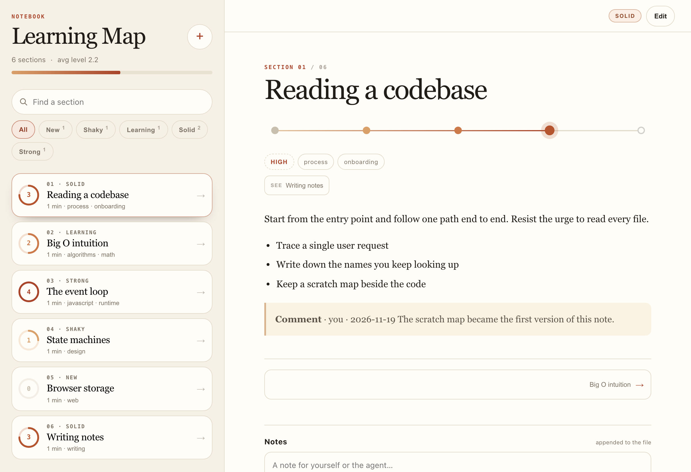
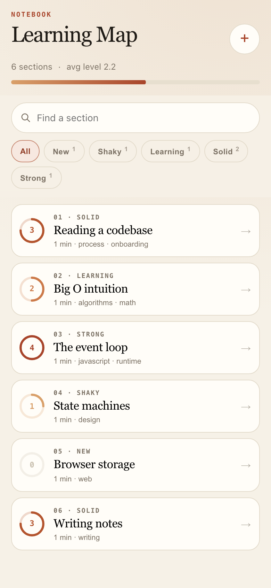

# markdownapps

A local-first Markdown app that runs entirely in the browser. One Markdown file
is the source of truth: topics, levels, links, notes, and comments all live in
the file. There is no server and no database; the app is a static bundle.

> **Browser support:** Chrome, Edge, Brave, or another Chromium browser. The app
> opens and saves files through the File System Access API, which Safari and
> Firefox do not provide yet.



<p align="center">
  
</p>

## Run it

Requires Node 20 or newer.

```bash
npm install
npm run dev       # http://localhost:4321
```

Build a static bundle:

```bash
npm run build     # writes dist/
npm run preview
```

Open the menu (bottom-left) → **Open file…** to pick a `.md`, or set a default
folder in **Settings** and create a note from the hub.

## Deploy on GitHub Pages

The repository includes `.github/workflows/deploy.yml`, which builds the app and
publishes `dist/` with GitHub Actions.

1. Push the repository to GitHub.
2. **Settings → Pages → Build and deployment → Source: GitHub Actions.**
3. Push to `main` (or run the workflow manually). The site appears at
   `https://<user>.github.io/<repo>/`.

The workflow derives the Vite base path from the repository name, so no config
is needed for a project site. A `<user>.github.io` repository, or a project with
a `public/CNAME` custom domain, is served from `/` instead. You can also set the
repository variable `BASE_PATH` to `/` explicitly
(**Settings → Secrets and variables → Actions → Variables**).

The same switch works locally:

```bash
BASE_PATH=/markdownapps/ npm run build
```

To offer Dropbox sync in the deployed app, set the repository variable
`VITE_DROPBOX_APP_KEY` and register the deployed URL (for example
`https://<user>.github.io/markdownapps/`) as a redirect URI in the Dropbox app.
The key is public by design; the PKCE flow has no client secret. Visitors can
also supply their own key from the console without a rebuild.

GitHub Pages serves over HTTPS, which is required for the File System Access API,
service workers, and the installable PWA. If you use a custom domain, update the
Dropbox redirect URI to match.

## How it works

markdownapps is a Vite + Svelte app. The browser does everything the old Node
host used to do:

| Concern | Implementation |
|---|---|
| Open / save a note | File System Access API (`showOpenFilePicker`, `createWritable`) |
| Default folder, recent files | Handles stored in IndexedDB |
| Live updates | Polls the open file every 2s while the tab is visible |
| Frontmatter | Small reader in `src/client/frontmatter.js` |
| Templates | Single `.markdownapps.svelte` files; import/export from the hub, compiled in the page |
| Sync | Optional Dropbox over CORS with PKCE |

The note file is still the only document store. Everything else is UI state or a
file handle kept in the browser.

## Hub

The menu is available on every screen:

- **Note** — current template, raw Markdown editor
- **Recent** — recent files, open a file, create a note
- **Templates** — starter apps and imported templates; import, export, remove
- **Settings** — default folder, Dropbox sync, storage notes

Settings, recents, the folder handle, imported templates, and the
disabled-template list live in the origin's IndexedDB. Clearing site data
resets them; your `.md` files are untouched.

## Templates

Each note declares its template in frontmatter:

```yaml
template: kanban
```

Starter templates:

| ID | App |
|---|---|
| `map` | Sections: numbered reading deck, level ladder, phone-first reader |
| `kanban` | Kanban: draggable cards and a modal editor |
| `network` | Network: full-canvas graph with connections and inspector |
| `todo` | Todo: tasks with priorities, due dates, and completion |
| `transactions` | Transactions: finance ledger with totals and categories |
| `quiz` | Quiz: reveal-answer review session with scoring |

Templates are single portable Svelte files. Each one carries its own manifest
comment:

```svelte
<!--
id: hello
name: Hello
version: 1
permissions: [document:read, document:write]
-->

<script>
  let { graph, actions } = $props();
</script>

<h1>{graph.title}</h1>
```

**Export** a template from **Hub → Templates** to get its `.markdownapps.svelte`
source. **Import** writes it back. There is no registry to edit: the file's
manifest is the registration. Importing the same `id` again replaces it, and
importing a bundled id (for example `map`) installs an override that removal
takes back.

Installed templates are compiled in the page by `svelte/compiler`, which is a
lazy ~226 KB gzip chunk. The compiler output is evaluated against a small set of
host modules (`svelte`, `svelte/transition`, `svelte/animate`, `svelte/store`,
`markdownapps/schema/topics`, …), so a template cannot import arbitrary packages or
use dynamic `import()`. Anything else is rejected with a list of what is
available.

To ship a starter with the build, drop the file in `src/templates/`. The folder
is discovered at build time; `order` in the manifest controls its position in
the hub (imported templates without one sort last).

> **Trust:** an installed template is code running in this page. It can read
> everything the origin can store, including sync tokens. Only import templates
> you have reviewed.

A removed template stays disabled in IndexedDB until you restore the starters;
removing an imported template deletes it.

If a note requests a template that is not available, markdownapps shows the template
name, a raw Markdown preview, and **Open raw Markdown**. It never silently
substitutes another app.

## Markdown format

````md
---
title: My Learning Map
description: Optional.
template: map
---

## Topic name

```yaml
level: 2
confidence: medium
prereqs: Topic A, Topic B
related: Topic C
tags: javascript, frontend
```

Normal Markdown content goes here.

> **Comment** · you · 2026-11-21
> Comments are appended here.
````

- `level` is `0`–`4`.
- `prereqs` and `related` are comma-separated titles.
- A prerequisite becomes a clickable link when its title matches another topic.
- Missing prerequisites are shown as “not mapped”.

Writes are guarded by a content hash: if the file changed underneath you (for
example, an agent edited it), saving is blocked until the next poll reloads it.

## Sync (Dropbox, optional)

Sync is still opt-in and now runs from the page using Dropbox's CORS API and
PKCE. No client secret and no bridge server are involved.

Setup:

1. Create a Dropbox app with **App folder** access.
2. Enable `files.content.read`, `files.content.write`, `files.metadata.read`,
   and `account_info.read`.
3. Register the app's URL as a redirect URI, for example
   `http://localhost:4321/` in development.
4. Build with an app key:

   ```bash
   VITE_DROPBOX_APP_KEY=your-key npm run build
   ```

   For a quick local test you can also run
   `localStorage.setItem("markdownapps.dropboxAppKey", "your-key")` in the console.

What syncs:

- The active note, mapped to `/markdownapps/<file name>` in the Dropbox app folder.
- Saves upload after a short debounce; remote changes are polled every 20s.
- If both sides changed, the local file stays live and the remote version is
  downloaded as `<name> (conflict remote <timestamp>).md`.
- Remote deletes never delete the local note.

Tokens live in IndexedDB. Unlike the old desktop build there is no `0600` file
protection, so treat the browser profile as the security boundary.

Zero-registration alternative: point the default folder at a folder that the
Dropbox or Google Drive desktop client already syncs. The 2s file poll picks up
changes, but conflict handling is then the provider's.

## What works

- Opens and saves a real `.md` file through the browser picker.
- Live-refreshes when another program changes the file (2s poll).
- Per-note templates: Sections, Kanban, Network, Todo, Transactions, Quiz.
- Import and export templates as single `.markdownapps.svelte` files at runtime.
- Hub with recent files, new note, folder setting, template management.
- Optimistic conflict check on save.
- Optional Dropbox sync with conflict copies and PKCE.
- Installable PWA shell (`public/manifest.webmanifest`, `sw.js`).

## Known limits

- Chromium-only file access; Safari and Firefox can render the app but cannot
  open files.
- No CLI (`markdownapps new`, `markdownapps show`) and no local HTTP API.
- No `fs.watch`: live updates are a visible-tab poll, so a closed tab sees
  nothing until it is reopened.
- Imported templates can only import the host modules listed above; dynamic
  `import()`, `import.meta`, and asset imports are rejected.
- Imported templates are not sandboxed. They run with the page's origin and can
  read anything it stores, including sync tokens.
- Installing a template evaluates compiled code with `new Function`, so a
  Content-Security-Policy without `unsafe-eval` blocks imports and installed
  templates. Bundled templates are unaffected.
- Sync tokens are stored in IndexedDB rather than an OS keychain.
- Opening the same file from two tabs is not coordinated beyond the hash check
  and polling; expect conflict copies.
- PWA install and service workers require HTTPS or `localhost`.
- No authentication. A static deployment is readable by anyone who can reach it;
  notes still stay in the browser because there is no server.

## Project layout

```text
markdownapps/
  index.html                    Vite entry
  vite.config.js                build config, base path, schema alias
  .github/workflows/            CI and GitHub Pages deploy
  .env.example                  optional Dropbox app key
  LICENSE                       MIT
  docs/                         README screenshots
  public/
    manifest.webmanifest        PWA manifest
    sw.js                       service worker
    .nojekyll                   keep GitHub Pages from running Jekyll
    icon-*.png, icon.svg
  src/
    main.js                     mounts App, registers the service worker
    app.css
    App.svelte                  host runtime
    client/
      index.js                  client API: notes, hub, settings, sync
      db.js                     IndexedDB key/value store
      files.js                  File System Access helpers
      frontmatter.js            minimal frontmatter reader
      manifest.js               template manifest parser
      compiler.js               in-page Svelte compile + module rewriting
      compiler-runtime.js       host modules available to templates
      scaffold.js               new-note scaffold
      sync.js                   Dropbox provider + sync engine
      templates.js              discovery, install/export/remove/restore
    components/                 HostMenu, MenuButton, TemplateHost, MissingTemplate
    schemas/topics.js           topic schema shared by the starter templates
    templates/                  portable *.markdownapps.svelte app sources
  dist/                         build output (generated)
```

## Contributing

Issues and pull requests are welcome. Use `npm ci`, then `npm run dev`. The CI
workflow builds every pull request; keep `npm run build` clean.

## History

Earlier versions shipped a Node CLI and HTTP host (`core/`) with template
compilation, a filesystem watcher, SSE, and a Dropbox loopback OAuth flow. That
runtime was removed in favour of the browser-only model described above. The
Markdown format and the template contract are unchanged.

## License

[MIT](LICENSE).
